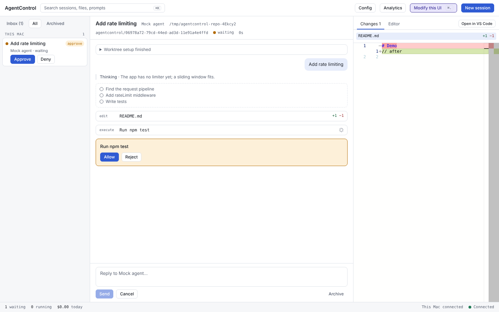

# AgentControl

AgentControl is an app for running coding agents (Claude Code, Codex) on your own computer. It shows
you which sessions are waiting for you, lets you approve what they ask to do, and lets you review
and edit what they changed. Each session works in its own git worktree, so your checkout stays
untouched. `AgentControl` is a working name.



*The default UI, driven by the test agent (no real model was used for this picture).*

## State of the project

Pre-release. There is no installer yet. **Running from source is the supported way today.**

- The target is macOS. It has been developed and tested on Linux. On a CI Mac runner (Apple Silicon)
  the build is green: the menu bar app (Swift) and the compiled app build for both chip types, and
  the compiled app passes a smoke test from the app bundle and from the mounted `.dmg`. No person has
  opened the `.dmg` on a real Mac yet, the menu bar app has not been launched, and the Intel build
  has not been run (see [docs/releasing.md](docs/releasing.md)).
- Claude Code has been driven for real from this UI (a one-word prompt worked). Codex has not been
  tried with a real account yet.
- When a `.dmg` is published, it will be **unsigned** (no Apple Developer ID yet). macOS will block
  it on first open. Open it through System Settings > Privacy & Security > Open Anyway, or run
  `xattr -dr com.apple.quarantine /Applications/AgentControl.app`.
- No Homebrew install and no automatic updates yet.
- Not finished: every planned screen exists (Workspaces menu and Add workspace, Config, the Terminal
  tab and Analytics), but none has been tried by hand much, nor have the "Modify this UI" panel and
  the Preview tab. The Terminal tab has not been run on a Mac. No real remote host has been tried.
  Analytics does not show usage against plan limits for subscription logins yet.

## Requirements

- [Bun](https://bun.sh) 1.4.4 (the version CI uses) and `git`.
- For real agents: Claude Code logged in on this machine. The relay downloads each agent's adapter
  itself, once, into its data folder the first time a session with that agent starts. That first
  session needs network access and can take a minute; later sessions use the installed copy and
  need no download. If the download fails, the session says so: check your internet connection and
  start the session again.
- No key is needed to try it with the built-in test agent (see below).

## Quick start

```sh
git clone https://github.com/zohrus/agentcontrol.git
cd agentcontrol
bun install
bun dev
```

`bun dev` prints one line, `AgentControl listening on http://127.0.0.1:4747`, and opens that
address in your browser the first time. Set `AGENTCONTROL_NO_OPEN=1` to stop it opening one.

If the port is taken, `bun dev` says so and exits. Pick another: `bun dev --port 4748`.

To try it without any key, point the "Mock agent" at the scripted test agent before starting:

```sh
echo '{"turns":[[{"kind":"reply","text":"Hello"},{"kind":"finish","stopReason":"end_turn"}]]}' > /tmp/mock.json
AGENTCONTROL_AGENT_MOCK_CMD='["bun","'$PWD'/e2e/support/mock-agent/main.ts"]' \
MOCK_AGENT_SCRIPT=/tmp/mock.json bun dev
```

The script format is in `e2e/support/mock-agent/script.ts`. "Mock agent" appears in the agent list
only when these variables are set.

## Your first session

1. Click **Add a repository** (or **New session**). In the dialog, choose **Add repository...** in
   the Repository list, type the full path of a git repository, and press **Add**.
2. Optional: open **Workspaces** > **Check and repair** to see the machine check and set which files
   (default `.env*`) are copied into each session's worktree and a setup script (for example
   `npm install`). The same menu adds a remote (SSH) workspace. **Config** opens the settings shared
   by your agents (MCP servers, instructions, hooks, skills); nothing is written to an agent's own
   files until you review the changes and press Apply.
3. Pick the agent, write what it should do, and press **Start**. The first start of a real agent
   downloads its adapter.
4. When the session shows **approve**, press **Approve** in the list or **Allow** in the
   conversation.
5. Open the **Changes** tab to see the diff since the base branch, the **Editor** tab to edit a file
   (Ctrl/Cmd+S saves), the **Terminal** tab for a shell in the session's folder, and **Archive** when
   done. Archive keeps the branch
   (`agentcontrol/<session id>`) and the conversation, and removes the worktree. It warns first if
   files are not committed: those are lost.

## Where your data lives

Everything is under `~/.agentcontrol/` (set `AGENTCONTROL_HOME` or `--data-dir` to change it).

| Path | What it is |
|---|---|
| `state.db` (and `-wal`, `-shm`) | The app's SQLite database: sessions and events. |
| `api-token` | The secret for the local API. New at every start, readable only by you. |
| `relay/relay.sock`, `relay.pid`, `relay.log` | The relay daemon's socket, process id and log. |
| `relay/repos.json` | The repositories you added, with their worktree setup. |
| `relay/sessions/<id>/events.jsonl` | The full log of one session. |
| `relay/worktrees/<id>/` | The working copy of each live session. |
| `ui/`, `ui-staging/`, `ui-template/`, `ui-upstream-version`, `ui.git/` | The copy of the UI that "Modify this UI" edits, its versions, and the default it came from. `bun dev` serves the UI from `packages/ui-template`; I have not checked whether Modify changes show up in `bun dev`. |

### Stopping the relay

The relay is a background process that keeps your agents running when you close the app. Closing
the app does not stop it. Quit the app first (Ctrl+C in the `bun dev` terminal), then:

```sh
bun packages/relay/src/main.ts stop --data-dir ~/.agentcontrol/relay
```

(Use your own data folder plus `/relay` if you changed it.) This stops the relay. If the app is still running, it starts a new relay within seconds, so quit the app first.
Check with `ps aux | grep "relay/src/main.ts daemon"`.

### Reset or uninstall

1. Archive your sessions in the app, or accept that their worktrees are removed below.
2. Quit the app and stop the relay as above.
3. `rm -rf ~/.agentcontrol`.
4. In each repository you used: `git worktree prune`, and delete the kept branches with
   `git branch --list 'agentcontrol/*'` and `git branch -D <name>`.

To start fresh but keep the repository, run the app with a new folder:
`AGENTCONTROL_HOME=/tmp/ac-test bun dev`.

## Security

The app listens on `127.0.0.1` only. Every request must come from a local page (`Host` and `Origin`
are checked, so other websites cannot drive it) and every API call needs the secret from
`~/.agentcontrol/api-token`. It does not protect against other programs running as your user, who
can read that token, the database and the relay socket, nor against another local process that can
reach the port and loads the page. Details: [the decision](docs/decisions/2026-11-22-local-server-security.md).

## For contributors

```sh
bun run check         # every quality gate, then the tests: must pass before anything lands
bun run test          # the end-to-end tests only
bun run prove-gates   # proves each quality gate really fails on a bad sample
bun run integrate <branch>   # rebase on main, run check, then push to main (--dry-run skips the push)
bun run build         # compile the binaries into dist/
```

Browser tests need Chromium: `bunx playwright install chromium`.

The rules in one paragraph: tests are end-to-end only (no unit tests), written as GIVEN / WHEN / THEN
comments against a scripted mock agent; functions and files are small (limits are enforced and are
never raised); packages follow fixed dependency rules; new dependencies need a good reason; changes
reach `main` through `bun run integrate`, not pull requests. Read [AGENTS.md](AGENTS.md) and
[CONTRIBUTING.md](CONTRIBUTING.md).

## Project layout

| Path | What it is |
|---|---|
| `packages/protocol` | Shared types and schemas. Imports nothing. |
| `packages/relay` | The daemon that runs agents (over ACP), keeps event logs, holds permission requests, makes worktrees. |
| `packages/app` | The local server: talks to the relay, stores state, serves the API and the UI. |
| `packages/sdk` | `@agentcontrol/sdk`, the typed client the UI uses. |
| `packages/ui-template` | The default web UI (React, Vite, Tailwind). |
| `packages/mac` | The menu bar app in Swift (built on a CI Mac runner; not launched by a person yet). |
| `e2e/` | End-to-end tests and the mock agent. |
| `scripts/` | Check, build, release and integrate scripts. |
| `docs/` | Plan, status and decisions. Index: [docs/README.md](docs/README.md). |

## Status and roadmap

| Phase | State |
|---|---|
| Relay, local app, SDK and default UI | Working from source |
| Modify agent (backend, `/_safe`, panel) | Working; the panel has browser tests but little hand use |
| Preview tab (HTML and Markdown) | Working |
| Mac app and `.dmg` | Built and smoke-tested on a CI Mac runner (Apple Silicon); unsigned; not yet tried by a person |
| Remote (SSH) workspaces | Backend and UI (Workspaces menu, Add workspace) done, tested against a local `sshd`; no real remote host tried |
| Harness config (MCP, skills, hooks) | Backend and Config screen done; secrets storage, per-session MCP servers and subagents not yet |
| Console (Terminal tab) | Working on Linux, also in the compiled app; not run on a Mac; no output backpressure yet |
| Analytics | Screen done (tokens, costs where the agent reports them, rule-based insights); no usage against plan limits yet |
| AI gateway, browser VS Code | Not started; optional |

Live status: [docs/status.html](docs/status.html). The full plan: [docs/plan.html](docs/plan.html).

## Troubleshooting

- **"Port 4747 is already in use."** Another copy is running. Open it, or use `bun dev --port 4748`.
- **Adding a repository says "is not a folder on this computer" or "is not a git repository".**
  Type the full path of an existing folder that is a git repository (`git init` it first).
- **A first session takes a long time.** The agent adapter is downloaded the first time. It needs
  network access.
- **The UI is broken after a change.** Open `http://127.0.0.1:4747/_safe`. It is served by the app
  itself and offers "Undo last change" and "Restore" for earlier versions.
- **A session is missing from the list.** Archived sessions are only under **Archived**.

## License

MIT. See [LICENSE](LICENSE).
